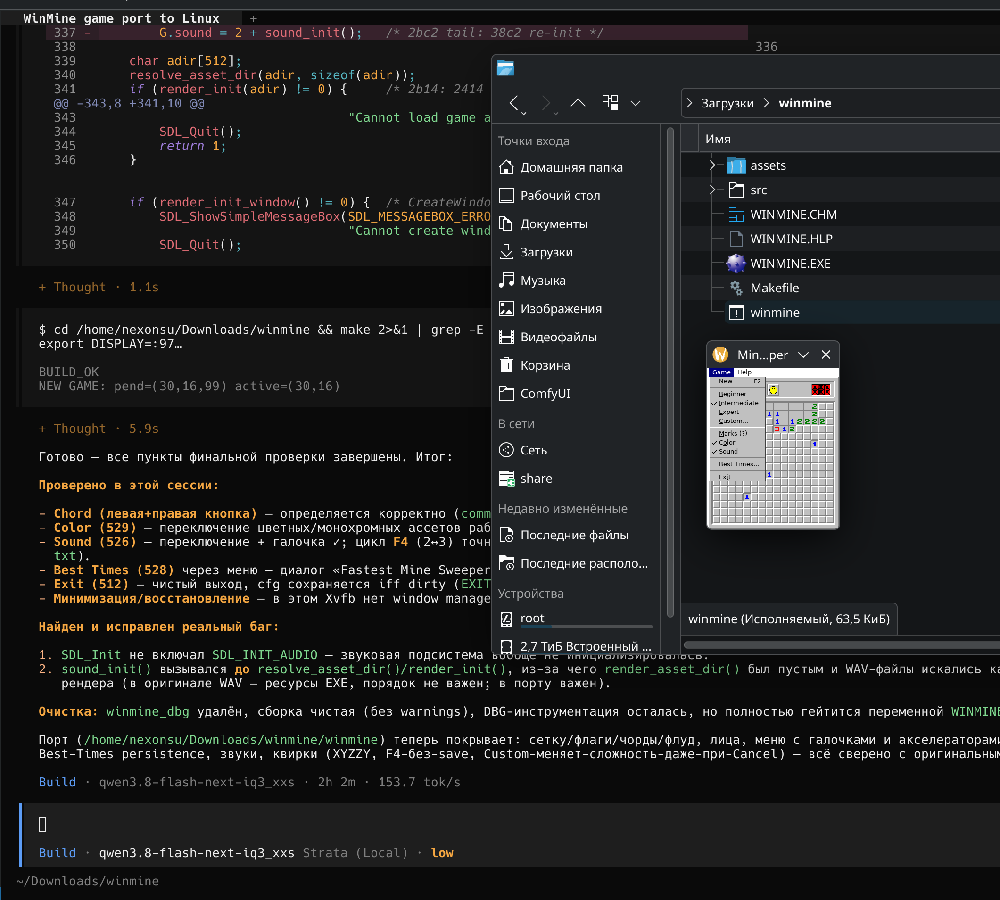

# Minesweeper Linux Recomp

[English](README.md) | [Русский](README_RU.md)

**PoC декомпиляции и портирования игры Minesweeper (`WINMINE.EXE`, эпоха
Windows XP) на Linux силами локальной LLM без обращения к внешним сервисам.**

Цель эксперимента — проверить, способна ли локально запущенная модель
полностью разобрать нативный Windows-бинарник, восстановить его логику и
написать на её основе независимую реализацию, воспроизводящую оригинал
включая поведение, ресурсы и даже quirks.

> **Неофициальный фанатский порт.** Проект не связан с Microsoft и не
> одобрен ею. «Minesweeper» — товарный знак Microsoft Corporation.
> Правовая оговорка о статусе файлов — в [`NOTICE_RU`](NOTICE_RU).

## Первый запуск порта



Скриншот первого запуска: слева — сессия OpenCode, справа — окно порта
(Expert 30×16/99, открытое меню Game) рядом с оригинальным `WINMINE.EXE`.

## Как это было сделано

1. **Реверс-инжиниринг.** Через MCP-сервер REA (`rea-agents`) модель
   декомпилировала `WINMINE.EXE` в Ghidra: ~150 функций восстановлены в
   псевдокод, разобраны ресурсы EXE (спрайты клеток/цифр/лиц, диалоги,
   меню, WAV-звуки), извлечены оригинальные ассеты в `assets/`.
2. **Построение модели данных.** По псевдокоду восстановлены: сетка
   `DAT_01005340[32*27]` с кольцом границы, состояния клеток (флаг,
   вопрос, мина, взорвавшаяся), счётчики, логика первого безопасного
   клика, flood-fill через кольцевую очередь на 100 слотов (как в
   оригинале), чорды, пауза, XYZZY-код.
3. **Портирование.** Написан независимый код на C11 + SDL2: собственный
   меню-бар, Win95-стиль модальных диалогов (Custom Field, Best Times,
   About, ввод имени), persistence в `~/.config/winmine/winmine.cfg`.
   PNG-спрайты декодируются vendored `stb_image`; текст меню и диалогов
   рисуется из предзаранее отрендеренного глиф-атласа DejaVuSans
   (снятого офлайн через FreeType, пиксель-в-пиксель совпадающего с
   выводом SDL2_ttf), встроенного в бинарник — SDL2_image/SDL2_ttf и
   шрифтовые файлы во время выполнения не нужны. Листы спрайтов, иконка
   и WAV-звуки тоже встроены в бинарник (`src/assets_data.h`) — как и в
   оригинале, где они лежат в ресурсах PE.
4. **Верификация.** Поведение порта сверялось с оригиналом, запущенным
   под wine: скриншоты диалогов, трассировка кликов/счётчиков, проверка
   quirks (F4 не сохраняет звук, Custom меняет сложность даже при Cancel,
   Marks-галочки, цикл флагов при выключенных метках).

## Окружение

| | |
|---|---|
| **ОС** | CachyOS x86_64 (Arch-based), ядро Linux 7.2.9-2-cachyos |
| **Рабочий стол** | KDE Plasma 6.7.5, KWin (Wayland) |
| **CPU** | AMD Ryzen 9 9950X3D (16C/32T, до 5.76 ГГц) |
| **GPU** | NVIDIA GeForce RTX 5090 (дискретная, GB202) + AMD Radeon 610M (встроенная) |
| **RAM** | 123.45 GiB |
| **Диски** | btrfs: `/` 931 GiB, `/home` 2.73 TiB |
| **Мониторы** | 3840×2160 ViewSonic PJ + PG32UCDP 32" 240 Hz |
| **Модель** | `qwen3.8-flash-next-iq3_xxs` — Qwen3.8-Flash-Next, квантование IQ3_XXS (GGUF, MoE, MTP-спекуляция, vision) |
| **Движок** | [Strata](docs/strata_RU.md) — локальный инференс-сервер (`/home/nexonsu/.strata/`, запуск через `run-iq3_xxs.sh`, OpenAI-совместимый API на :8080) |
| **Агент** | [OpenCode](docs/opencode_RU.md) + MCP REA (Ghidra) |

Полный снимок системы — в [`docs/fastfetch.txt`](docs/fastfetch.txt).

Вся работа — декомпиляция, написание кода, сборка, отладка и визуальная
верификация — выполнена моделью автономно в сессии OpenCode.

## Сборка

Сборка по умолчанию упаковывает в бинарник всё: статически линкуется
собранный из исходников SDL2 2.32.10, PNG декодируются vendored
`stb_image`, текст рендерится из встроенного глиф-атласа, игровые ассеты
(листы спрайтов, иконка, WAV-звуки) встроены в бинарник. Итоговый
`winmine` запускается автономно — без установленных пакетов SDL/шрифтов и
без файлов ассетов (бэкенды X11/Wayland и ALSA/PulseAudio подгружаются
динамически во время выполнения).

```sh
make deps     # скачать и собрать статический SDL2 2.32.10 (нужны curl, cmake, X11-заголовки)
make          # -> ./winmine (~2.6 МБ, самодостаточный)
./winmine
```

Быстрая альтернатива — линковка к системному общему SDL2 (нужен только
пакет `sdl2` для pkg-config):

```sh
make sys
```

`make assets` перегенерирует встроенные ассеты из `assets/` (нужен `xxd`).
Файлы в каталоге `assets/` рядом с бинарником имеют приоритет над
встроенными (удобно для модов); `WINMINE.HLP` остаётся внешним файлом —
пункт меню Help передаёт его системному просмотрщику помощи.

## Структура

```
src/          исходники порта (C11 + SDL2)
tools/        офлайн-дампер глиф-атласа (FreeType), подмножество DejaVu + лицензия
third_party/  vendored stb_image (исходники SDL2 скачиваются через `make deps`)
assets/       извлечённые из оригинала спрайты, WAV, иконка, HLP
              (встраиваются в бинарник через `make assets`; внешние копии
              перекрывают встроенные, HLP остаётся внешним)
docs/         описание движка Strata, конфигурации OpenCode, скриншоты
Makefile      сборка
```

## Лицензия

Оригинальный код проекта (`src/`, `Makefile`, документация) — под
[MIT](LICENSE). Игровая механика воспроизведена независимо (clean-room),
оригинальный `WINMINE.EXE` и его код в репозитории отсутствуют.

Файлы в `assets/` извлечены из `WINMINE.EXE`, остаются собственностью
Microsoft и **не** лицензируются MIT — см. [`NOTICE_RU`](NOTICE_RU).

Сторонние компоненты: `third_party/stb/` (stb_image, public domain);
`tools/DejaVuSans-subset.ttf` (подмножество DejaVu Sans под лицензией
Bitstream Vera, см. `tools/DejaVuSans-LICENSE.txt`), чьи заранее
отрендеренные глифы встроены в бинарник как `src/font_atlas.h`; SDL2
(лицензия zlib) скачивается и собирается локально через `make deps`
и в репозиторий не входит.
